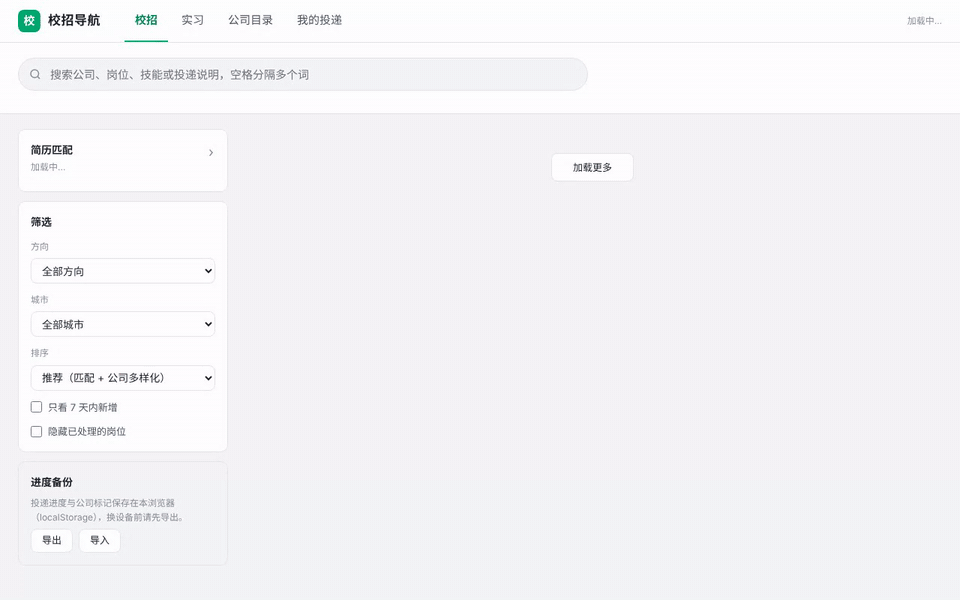

<div align="center">

# 校招导航 Campus Nav

**2027 届校招与实习岗位聚合平台 · 每日自动更新 · 按简历智能排序**

[在线使用](https://haofu794.github.io/campus-nav/) · [设计文档](docs/DESIGN.md) · [演示视频](docs/demo.mp4)



</div>

校招信息分散在上千家企业各自的招聘官网、聚合平台和公众号里。校招导航每天自动采集 1000 余家企业公开发布的校招与实习岗位，统一清洗、去重和分类，再根据求职者的简历计算匹配度并排序。所有岗位直接链接到企业官网的投递页面。

## 功能特性

- **岗位聚合**：覆盖互联网大厂、央国企（含二级单位）、银行、外企等 1022 家企业，当前收录 31,822 个岗位，其中校招 21,301 个、实习 10,521 个。
- **每日更新**：GitHub Actions 每天北京时间 07:00 自动运行。采集失败的来源沿用前一日数据，不会出现岗位突然消失。
- **简历匹配**：上传 PDF 简历或粘贴文字，在浏览器本地识别技能并重新排序。简历不会离开本机。
- **公司目录**：无法直接采集岗位的企业同样收录，提供官网入口、开启时间和投递说明（公众号、邮箱、内推方式等）。
- **投递管理**：为岗位标记"想投 / 已投递 / 笔试 / 面试 / Offer"等状态，在"我的投递"中统一跟进，支持导出和导入。
- **零后端**：纯静态页面部署在 GitHub Pages，无服务器、无数据库、无 API 调用费用。

## 快速上手

1. 打开 [在线页面](https://haofu794.github.io/campus-nav/)，在"校招"或"实习"中浏览岗位。
2. 用顶部搜索框和左侧筛选缩小范围：企业类型、方向、城市可以组合使用，搜索支持空格分隔多个关键词。
3. 展开左侧"简历匹配"，上传简历后点击"重新打分"，列表会按你的技能重新排序，匹配的技能以绿色标出。
4. 点击"去投递"跳转企业官网；用"标记状态"记录进度，所有记录保存在当前浏览器中。

## 数据覆盖

| 来源 | 说明 |
|---|---|
| campus-radar | 字节、腾讯、阿里、美团、百度等 17 家头部企业的公开索引 |
| 飞书招聘 | `*.jobs.feishu.cn` 及使用飞书的企业自有域名 |
| 北森 | `*.zhiye.com`，央国企、保险、车企、银行常用，兼容旧版 HTML 门户 |
| 大易 hotjob | 新版租户接口与旧版 `/wt/` 接口 |
| 国聘 | 央国企及二级单位，按 34 个省份 × 校招/实习 分片查询 |
| 中国平安 | 自建系统，覆盖平安科技、平安银行、寿险、产险等子公司 |

企业名单来自 [2027qiuzhao](https://github.com/ouput/2027qiuzhao) 并补充了部分银行。许多企业的"自建官网"实际运行在飞书、北森或大易之上，系统会自动识别底层平台并调用对应的采集器（`scraper/detect.py`）。

2026-11-10 的覆盖情况：

| 状态 | 企业数 |
|---|---|
| 已接入，可直接查看岗位 | 306 |
| 自研招聘系统，提供官网入口与投递说明 | 413 |
| 官网暂时无法访问，提供入口 | 136 |
| 使用 Moka（接口加密，不做破解），提供入口 | 86 |
| 仅公众号或邮箱投递，提供投递说明 | 81 |

## 系统架构

```
招聘网站 ──► scraper/ 采集 ──► etl/ 清洗合并 ──► matching/ 匹配排序 ──► web/data.json ──► web/ 静态页面
                │                    │                     │
          平台自动识别           城市标准化              BM25 + Embedding 双路召回
          限速与重试             方向分类               多特征加权排序
          失败回退               跨平台去重             MMR 多样性重排
```

三个阶段相互独立：某个网站改版只影响采集，分类规则调整只需重跑 ETL，不必重新抓取。

## 推荐算法

采用搜索推荐系统常见的"召回 → 排序 → 重排"三阶段结构：

- **召回**：BM25（`matching/bm25.py`，中文按二元组切分）负责精确的关键词匹配；bge-small-zh 向量（`matching/embed.py`）负责语义匹配，例如"智能体"和"Agent"。两路各取前 1000 个岗位，合并作为候选集。
- **排序**：对 embedding 相似度、方向、城市等特征做加权求和。权重通过交叉验证在人工标注上选出（`matching/tune.py`）。另设一个 `avoid` 扣分特征（`matching/fit.py`），用于识别"文字相似但不适合"的岗位，例如要求论文的研究型岗位。
- **重排**：MMR（Maximal Marginal Relevance）降低同一企业岗位的重复度，避免推荐列表被单一公司占满。

每个岗位都会显示得分理由，例如"语义相近（关键词没对上）"或"⚠ 偏研究/要论文"。

## 离线评估

基于 140 条人工标注（2 = 想投，1 = 可能投，0 = 不投），以 NDCG 作为指标：

| 实验 | 结论 |
|---|---|
| 10 × 5 折交叉验证调权重 | 在未参与调参的数据上，NDCG@10 从 0.72 提升到 0.82 |
| LLM-as-a-judge（gpt-5-mini） | 与人工标注的 Cohen's κ 仅 0.31；其误差与排序特征正相关（与 embedding 的相关系数 +0.34），存在 circularity 偏差，不能直接用于评估 |
| PPI 与 Horvitz–Thompson 估计 | 使用随机抽样的人工标注做无偏修正：调参后的权重比初始权重高约 0.3（95% 置信区间下限接近 0） |

实验过程、负面结果和取舍记录在 [docs/DESIGN.md](docs/DESIGN.md) 第 9 节。复现命令：

```bash
python -m matching.evaluate tune        # 交叉验证调权重
python -m matching.evaluate llm-label   # LLM 标注（需在 .env 中配置 LLM_API_KEY）
python -m matching.evaluate ppi         # 一致性、偏差检查与修正估计
```

## 本地运行

需要 Python 3.10 或更高版本。

```bash
git clone https://github.com/haofu794/campus-nav.git
cd campus-nav
pip install -r requirements.txt

python run.py --quick                  # 快速试运行，约 2–3 分钟
python -m http.server -d web 8000      # 浏览器打开 http://localhost:8000
```

完整运行（`python run.py`）需要访问 300 余个招聘网站，请求间隔 0.8–1.2 秒，耗时约 40–60 分钟。常用参数：

```bash
python run.py --skip-scrape --no-detect   # 不联网，仅用已有数据重新清洗和排序
python run.py --only hotjob --merge       # 只更新某一个平台，其余保留
python run.py --no-embed                  # 不使用 embedding（无需安装 fastembed）
```

### 使用自己的简历

```bash
mkdir resume && cp 你的简历.pdf resume/    # resume/ 已加入 .gitignore
python -m matching.profile resume/你的简历.pdf
```

默认使用技能词典提取，不产生费用。在 `.env` 中配置 `LLM_API_KEY`（以及可选的 `LLM_BASE_URL`、`LLM_MODEL`，兼容任意 OpenAI 接口）后，会改用 LLM 提取。偏好的方向、城市、回避规则和排序权重在 `config/my_prefs.json` 中配置。

### 部署自己的实例

1. Fork 本仓库。
2. 在仓库 Settings → Pages 中，将 Source 设为 **GitHub Actions**。
3. 在 Actions 页面手动运行一次 `daily-update`，之后每天自动更新。

`data.json` 约 20 MB，每天通过 Pages 发布，不提交进 git 仓库，避免仓库体积持续增长。工作流运行时会从线上页面取回前一天的数据，用于失败回退和记录岗位首次出现日期。若大平台当天采集到 0 个岗位，或超过 30% 的来源失败，健康检查会将本次运行标记为失败，GitHub 会发送邮件通知（`tools/healthcheck.py`）。

## 目录结构

```
scraper/     各平台采集器、招聘系统自动识别、限速会话
etl/         城市标准化、方向分类、技能抽取、去重与历史记录
matching/    BM25、embedding、排序、MMR、评估与调参
config/      企业补充名单、偏好与权重、简历技能
web/         静态页面（index.html / style.css / app.js）
docs/        设计文档与演示
tools/       健康检查、演示录制脚本
```

## 数据与合规声明

- 仅采集企业公开发布的岗位信息，不采集个人信息。每日运行一次，请求之间留有间隔，不绕过任何访问限制或加密措施。
- 页面只展示岗位名称、城市、类别等摘要信息，投递一律跳转企业官网。岗位信息以企业官网为准。
- 本项目与所列企业及招聘平台无任何关联。如有企业或平台希望移除相关信息，请提交 Issue。

## 路线图

- [x] 多平台采集、ETL、静态页面、每日自动更新
- [x] 简历解析、双路召回、加权排序、MMR 重排
- [x] 交叉验证调参、LLM-as-a-judge 与 PPI 评估、`avoid` 回避特征
- [ ] 为高优先级的自研招聘系统编写采集器（Kimi、智谱、米哈游、网易等）
- [ ] 页面内的偏好设置（方向、城市、回避规则）
- [ ] 单元测试

## 致谢

- [campus-radar](https://github.com/Ajax-1/campus-radar)（MIT License）：头部企业岗位索引
- [ouput/2027qiuzhao](https://github.com/ouput/2027qiuzhao)：2027 届校招企业名单
- [BAAI/bge-small-zh-v1.5](https://huggingface.co/BAAI/bge-small-zh-v1.5) 与 [fastembed](https://github.com/qdrant/fastembed)

## License

[MIT](LICENSE)
